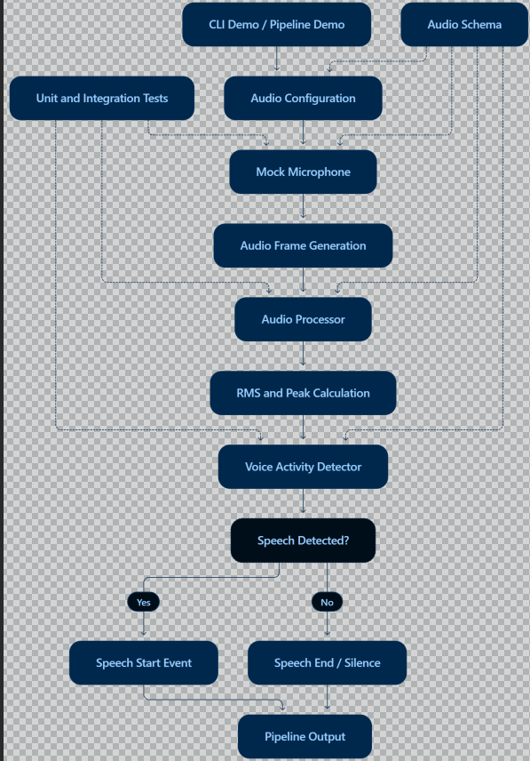

# AI Voice Co-Pilot – Audio Pipeline

## 1. Project Overview

The AI Voice Co-Pilot Audio Pipeline is a TypeScript-based implementation that demonstrates the initial audio processing workflow of a voice-enabled AI assistant.

The system uses a mock microphone to generate audio frames, processes the audio data, calculates audio characteristics and detects speech activity.

This implementation provides a foundation for developing a complete AI Voice Co-Pilot system.

## 2. Objectives

* Define structured audio schemas.
* Implement a mock microphone source.
* Generate and process audio frames.
* Calculate RMS and peak amplitude.
* Detect speech start and speech end.
* Develop a command-line demonstration.
* Implement unit and integration tests.

## 3. Technologies Used

* TypeScript
* Node.js
* Vitest
* tsx
* DataView and Uint8Array

## 4. Project Structure

```text
llmaudio/
│
├── src/
│   ├── audio/
│   │   ├── mock-microphone.ts
│   │   ├── audio-processor.ts
│   │   ├── vad.ts
│   │   └── processor.test.mts
│   │
│   ├── schemas/
│   │   └── audio.schema.ts
│   │
│   ├── cli.ts
│   └── pipeline-demo.ts
│
├── tests/
│   ├── mock-microphone.test.mts
│   ├── vad.test.mts
│   ├── audio-pipeline.integration.test.mts
│   └── image.png
│
├── .gitignore
├── package.json
├── package-lock.json
├── tsconfig.json
└── README.md


Note: The Audio Processor test is currently located at src/audio/processor.test.mts.

## 5. Core Components

### Audio Schema

Defines the structure of audio configurations, audio frames, microphone events, VAD events and pipeline status.

### Mock Microphone

Simulates microphone input and generates audio frames using the configured sample rate, bit depth and channel count.

### Audio Processor

Processes audio frames and calculates:

* Sample count
* Duration
* RMS amplitude
* Peak amplitude

### Voice Activity Detector

Identifies speech activity using an RMS threshold.

It generates:

* `speech_start`
* `speech_end`

### CLI Demo

Demonstrates audio frame generation and speech activity detection through a command-line interface.

### Pipeline Demo

Demonstrates the complete workflow from mock microphone input to audio processing and speech detection.

## 6. Audio Processing Workflow



The audio pipeline follows these steps:

1. **Initialization:** Load the audio configuration.
2. **Audio Input:** Start the mock microphone.
3. **Frame Generation:** Generate audio frames.
4. **Audio Processing:** Calculate RMS and peak amplitude.
5. **Speech Detection:** Analyze RMS values using VAD.
6. **Event Generation:** Identify speech start and speech end.
7. **Output:** Display processing results.


## 7. Installation

Install project dependencies:

npm install

## 8. Running the Project

Run the CLI demonstration:

npm run demo


Run the complete audio pipeline demonstration:

npm run pipeline


Run unit and integration tests:

npm test


Check TypeScript compilation:

npx tsc --noEmit

## 9. Testing and Coverage Results

The project has been tested using Vitest and the V8 coverage provider.

### Test Execution Results

| Component                  | Number of Tests | Status         |
| -------------------------- | --------------: | -------------- |
| Mock Microphone            |               4 | Passed         |
| Audio Processor            |               4 | Passed         |
| Voice Activity Detector    |               5 | Passed         |
| Audio Pipeline Integration |               1 | Passed         |
| **Total**                  |          **14** | **All Passed** |

### Code Coverage Report

| Coverage Metric | Percentage |
|-----------------|-----------:|
| Statements      | 96.36%     |
| Branches        | 83.33%     |
| Functions       | 100%       |
| Lines           | 100%       |
### Verification

* All 14 unit and integration tests passed.
* CLI demonstration executed successfully.
* Audio pipeline demonstration executed successfully.
* TypeScript compilation completed without errors.

The results demonstrate that the core audio processing components are functioning correctly and have strong automated test coverage.


## 10. Current Limitations

* The microphone is simulated rather than connected to a physical microphone.
* Speech detection uses an RMS threshold.
* Speech-to-text and text-to-speech are not yet implemented.
* The current implementation does not use an external AI model.

## 11. Future Enhancements

* Real-time microphone input.
* Speech-to-text integration.
* Text-to-speech functionality.
* Noise reduction.
* Improved voice activity detection.
* Integration with an LLM.
* Context-aware AI responses.

## 12. Conclusion

The project successfully demonstrates the foundational audio pipeline of an AI Voice Co-Pilot. It establishes structured audio data handling, mock microphone input, audio processing, speech activity detection and automated testing.

